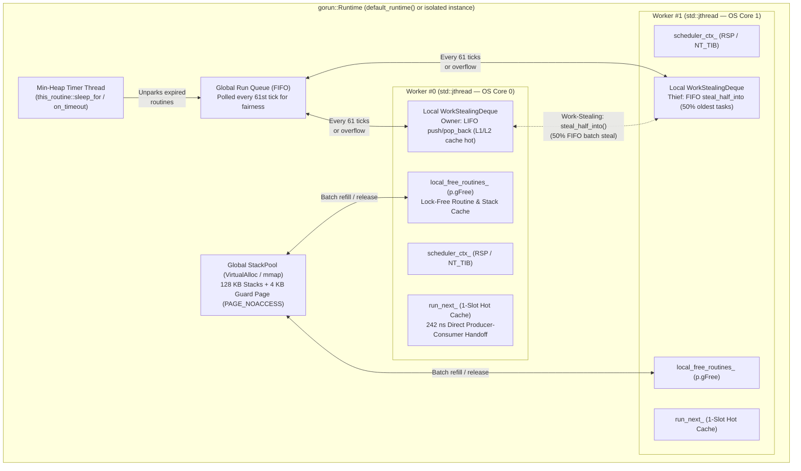
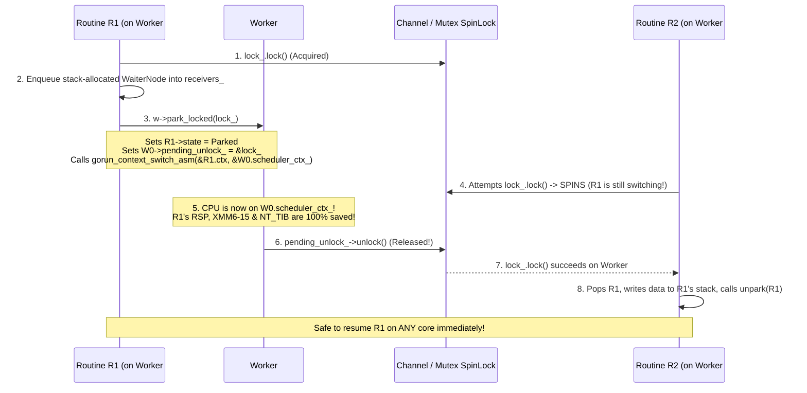
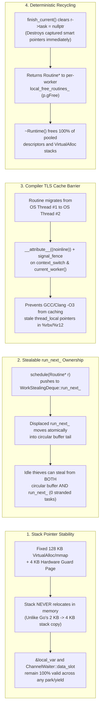
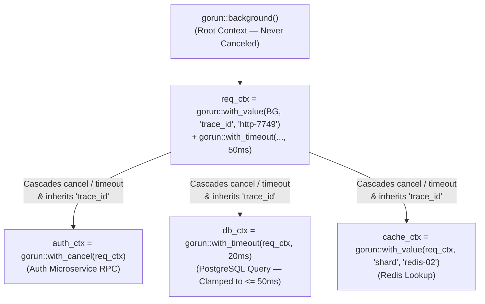
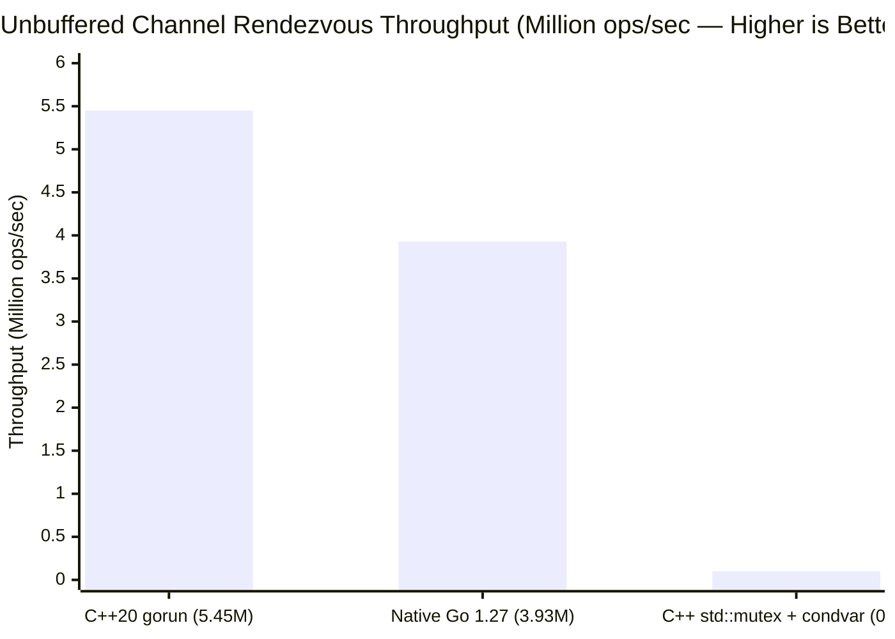

<div align="center">
  
  <h1><code>gorun</code> — High-Performance M:N Green Threads, Channels &amp; Structured Concurrency for C++20/23</h1>
</div>

[](./LICENSE)
[](https://en.cppreference.com/w/cpp/20)
[-success)](#quick-start--installation-how-to-use-gorun-in-your-project)
[-2088FF?logo=github-actions)](./.github/workflows/ci.yml)
[](https://takatochi.github.io/gorun/)

`gorun` is a header-only, zero-dependency C++20/23 concurrency runtime bringing **Go's M:N work-stealing scheduler (`G-M-P`)**, **isolated stackful routines**, **zero-copy typed channels (`Channel<T>`)**, **`select(...)` multiplexing**, **`GORUN_DEFER`**, and **C++-safe structured concurrency (`Scope` / `TaskGroup`)** to modern C++.

Created by **Artur Havor (Гавор Артур)** and licensed under the permissive **[Apache License 2.0](./LICENSE)**.

---

## Quick Start & Installation (How to Use `gorun` in Your Project)

Because `gorun` is **100% header-only** with **zero external dependencies**, you can integrate it into any C++20/23 project in seconds using one of the 4 standard methods below:

### Option 1: CMake `FetchContent` (Recommended — Zero Manual Setup)
Add this directly to your project's `CMakeLists.txt`. CMake will automatically download `gorun` and configure the `gorun::gorun` target:

```cmake
include(FetchContent)

FetchContent_Declare(
    gorun
    GIT_REPOSITORY https://github.com/Takatochi/gorun.git
    GIT_TAG        v0.4.0 # or main
)
FetchContent_MakeAvailable(gorun)

add_executable(my_app main.cpp)
target_link_libraries(my_app PRIVATE gorun::gorun)
```

### Option 2: Single-Header or `include/gorun` Drop-In
Copy either the single amalgamated header [`single_include/gorun/gorun.hpp`](./single_include/gorun/gorun.hpp) (generated by `python scripts/amalgamate.py`) or the full [`include/gorun`](./include/gorun) directory into your project and `#include "gorun/gorun.hpp"`:

```bash
# Compile directly with GCC / Clang / MinGW-w64 (modular headers):
g++ -std=c++20 -O3 -pthread -Iinclude main.cpp -o my_app

# Or compile against the single-header distribution (Linux/macOS):
g++ -std=c++20 -O3 -pthread -Isingle_include main.cpp -o my_app

# On Windows (MinGW/GCC) when using gorun::net sockets:
g++ -std=c++20 -O3 -pthread -Isingle_include main.cpp -o my_app.exe -lws2_32 -lmswsock
```

### Option 3: Git Submodule + `add_subdirectory`
```bash
git submodule add https://github.com/Takatochi/gorun.git external/gorun
```
Then in your `CMakeLists.txt`:
```cmake
add_subdirectory(external/gorun)
target_link_libraries(my_app PRIVATE gorun::gorun)
```

### Option 4: System-Wide CMake Install + `find_package(gorun)`
```bash
git clone https://github.com/Takatochi/gorun.git
cd gorun
cmake -B build -DCMAKE_BUILD_TYPE=Release
cmake --install build --prefix /usr/local   # or C:/Program Files/gorun on Windows
```
Then in any downstream CMake project:
```cmake
find_package(gorun 0.4.0 REQUIRED CONFIG)
target_link_libraries(my_app PRIVATE gorun::gorun)
```

### Option 5: vcpkg & Conan 2.0 Package Managers
Ready-to-use port/recipe files are bundled in [`packaging/vcpkg/`](./packaging/vcpkg/) and [`packaging/conan/`](./packaging/conan/):

```bash
# vcpkg (overlay port):
vcpkg install gorun --overlay-ports=./packaging/vcpkg

# Conan 2.0 (local recipe + test_package):
conan create packaging/conan --version=0.4.0 --build=missing
```

### Minimal 15-Line Example (`main.cpp`)
```cpp
#include <iostream>
#include "gorun/gorun.hpp"

int main() {
    gorun::Channel<int> ch(4);

    gorun::go([&]() {
        GORUN_DEFER { ch.close(); }; // Guaranteed channel close on scope exit!
        ch.send(42);
    });

    if (auto v = ch.recv()) {
        std::cout << "Hello from green routine: " << *v << "\n";
    }
}
```

---

## Key Architectural Invariants

1. **Zero OS-Thread Blocking on User Synchronization:**
   All `gorun` primitives (`Channel<T>`, `Mutex`, `CondVar`, `WaitGroup`, `Semaphore`, `Once`, `RwMutex`, `sleep_for`) **never block the underlying OS worker thread (`std::jthread`)**. Instead, they park the calling green routine in ~15–65 ns via a user-space assembly context switch and immediately yield the OS thread to other runnable routines.
2. **Structured Concurrency by Default (`Scope` / `TaskGroup`):**
   Unlike Go (where a compiler escape-analysis pass moves local variables captured by reference to the garbage-collected heap), C++ destroys stack variables upon scope exit. `gorun::Scope` and `gorun::TaskGroup` guarantee that all spawned child routines finish before the lexical scope exits—even when launched with plain `gorun::go([&]{ ... })` inside the block!
3. **Stack Stability Invariant:**
   Go dynamically reallocates and copies goroutine stacks when they grow, invalidating raw pointers into the stack. `gorun` allocates fixed virtual-memory stacks (`VirtualAlloc` / `mmap`) with a hardware **Guard Page** (`PAGE_NOACCESS` / `PROT_NONE`) at the bottom and caches them in a lock-free per-worker pool (`p.gFree` + `StackPool`). Stack addresses **never move**, making pointers and references to local stack variables 100% valid across suspension points (`park` / `yield`).
4. **Exception Safety:**
   An uncaught C++ exception inside a green routine never crashes the OS worker thread (`std::terminate`). Inside `TaskGroup`, `Scope`, `JoinHandle<T>`, or `Runtime::block_on()`, exceptions are captured via `std::exception_ptr`, automatically trigger cooperative cancellation (`std::stop_token`) of sibling routines, and are rethrown cleanly to the awaiting caller.

---

## Visual Architecture & Execution Diagrams

### 1. M:N Work-Stealing Scheduler Architecture (`G-M-P` Model in C++20)



---

### 2. Zero-Copy Direct Stack-to-Stack Channel Handoff (`capacity == 0` & Parked Readers)

Unlike traditional C++ thread queues that allocate nodes on the heap (`std::queue<T>` + `std::mutex`), `gorun::Channel<T>` places the `ChannelWaiter<T>` node and the destination `std::optional<T>` **directly on the sleeping routine's stack frame**. Because of the **Stack Stability Invariant**, the sender writes straight into the receiver's stack memory:

```
+---------------------------------------+         +---------------------------------------+
|     Green Routine R1 (Receiver)       |         |       Green Routine R2 (Sender)       |
|   Stack Frame (128 KB + Guard Page)   |         |   Stack Frame (128 KB + Guard Page)   |
+---------------------------------------+         +---------------------------------------+
| std::optional<T> result_slot;         | <-----+ | T value = 42;                         |
| ChannelWaiter<T> node {               |       | |                                       |
|   .waiter    = &R1,                   |       | | ch.send(std::move(value)):            |
|   .data_slot = &result_slot  ---------+-------+ |   1. Pops R1's node from receivers_   |
| };                                    |         |   2. *dst = std::move(value)          |
| [State: Parked]                       |         |      (Direct Stack-to-Stack Copy!)    |
+---------------------------------------+         |   3. w->run_next_ = &R1 (unpark!)     |
|     PAGE_NOACCESS (4 KB Guard Page)   |         +---------------------------------------+
+---------------------------------------+         |     PAGE_NOACCESS (4 KB Guard Page)   |
                                                  +---------------------------------------+
```

---

### 3. Atomic `park_locked` / `unpark` Protocol (Zero Lost Wakeups & Zero Dual-Core Stack Corruption)

A naive green-thread scheduler that unlocks a primitive's spinlock *before* calling `context_switch` suffers from a fatal race condition: another CPU core can pop the routine from the wait queue and start executing its stack **while the first CPU core is still saving registers onto that same stack**.

`gorun` solves this identically to Go's `gopark(unlockf, lock)` by passing `pending_unlock_` into the worker's `scheduler_ctx_`:



---

### 4. Why `gorun::Scope` Exists: Memory Layout in Go (Escape Analysis) vs. C++20 (`gorun`)

In Go, if a goroutine captures a local variable `x` from a function that returns immediately, the Go compiler's **escape analysis** silently moves `x` to the garbage-collected heap. In C++, local variables live strictly on the stack frame—if a detached thread accesses `&x` after the function returns, it causes a **Use-After-Free (Dangling Reference)**.

`gorun::Scope` brings compile-time/RAII safety to `[&]` captures while preserving Go's clean `go([&]{ ... })` syntax:

```
  GO COMPILER (Escape Analysis + GC)                 C++20 gorun::Scope (Zero Heap + RAII Join)
+------------------------------------+             +--------------------------------------------+
| func foo() {                       |             | void foo() {                               |
|   x := 42 // Escapes to GC Heap!   |             |   int x = 42; // Stays on fast CPU stack!  |
|   go func() { use(&x) }()          |             |   gorun::Scope scope;                      |
| } // foo() returns early           |             |   gorun::go([&]() { use(x); });            |
+-----------------+------------------+             | } // ~Scope() parks here until go() ends!  |
                  |                                +---------------------+----------------------+
                  v                                                      |
        +-------------------+                                            v
        |  GC Heap Object   |                              +---------------------------+
        |  int x = 42       |                              | Zero Heap Allocation!     |
        |  (GC overhead)    |                              | 100% Dangling-Ref Safe!   |
        +-------------------+                              +---------------------------+
```

---

### 5. Why Pointers Never Get Lost or Corrupted in `gorun` (4-Layer Pointer Safety Architecture)

A common failure mode in custom M:N green-thread runtimes is pointer corruption or lost pointers during cross-core migrations. `gorun` eliminates all 4 classes of pointer bugs at the architectural level (verified by **`[TEST 20]`** with an exact constructor/destructor audit of 10,500 objects):



| Pointer Category | What Goes Wrong in Naive Runtimes (or Go) | How `gorun` Guarantees Zero Lost / Dangling Pointers |
| :--- | :--- | :--- |
| **1. Pointers to Local Stack Variables (`&local_var`)** | Go starts with 2 KB stacks and **reallocates/copies the entire stack** to a new address when it grows, breaking C++ raw pointers into the stack. | **Fixed Virtual Stacks (`StackPool`)**: 128 KB + 4 KB `PAGE_NOACCESS` Guard Page. Stack addresses **never change** for the lifetime of the routine (`[TEST 04]`). |
| **2. `Routine*` Pointers Across Queues & `run_next_`** | If a worker caches a routine in an unlocked `run_next_` slot and then runs a long CPU task, the pointer is invisible to work-stealing thieves or lost on overwrite. | **Unified Lock-Guarded `run_next_`** inside `WorkStealingDeque`: `push_run_next()` atomically displaces any previous routine into the ring buffer, and `steal_half_into()` steals directly from `run_next_` when the buffer is empty. |
| **3. `thread_local` Pointers (`current_worker()`) on `-O3`** | Optimizing compilers assume a function call cannot change the OS thread, so they cache `thread_local` addresses in callee-saved registers (`%rbx`) across `context_switch`! | **TLS Reload Barrier**: `context_switch()`, `current_worker()`, and `current_routine()` are marked `noinline` with `std::atomic_signal_fence(memory_order_seq_cst)`, forcing fresh `%gs`/`%fs` TLS reads after migration. |
| **4. Smart Pointers Inside Routine Closures (`std::shared_ptr<T>`)** | Pooled routines keep their last `std::function<void()> task` alive in the pool, leaking captured `std::shared_ptr` resources until program exit. | **Immediate Closure Reset**: `routine_trampoline` explicitly executes `r->task = nullptr;` *before* calling `finish_current()`, destroying all captured closures immediately (`[TEST 20]: Constructed 10500 == Destroyed 10500, Live Leaks: 0`). |

---

## Side-by-Side Code Comparisons: Go vs. `gorun` (C++20) vs. Standard C++ (`std::thread`)

### Comparison A: Unbuffered Channel Ping-Pong
| Go (`chan int`) | C++20 `gorun` (`gorun::Channel<int>`) | Standard C++20 (`std::jthread` + `std::mutex`) |
| :--- | :--- | :--- |
| ```go ch := make(chan int) go func() {   ch <- 42 }() v := <-ch ``` | ```cpp gorun::Channel<int> ch(0); gorun::go([&]() {     ch.send(42); }); auto v = ch.recv(); // *v == 42 ``` | ```cpp std::mutex m; std::condition_variable cv; std::optional<int> slot; std::jthread t([&]() {     std::lock_guard lk(m);     slot = 42;     cv.notify_one(); }); std::unique_lock lk(m); cv.wait(lk, [&]{ return slot.has_value(); }); // Blocks OS kernel thread! ``` |

### Comparison B: Multi-Channel Multiplexing (`select`)
| Go (`select`) | C++20 `gorun` (`gorun::select`) |
| :--- | :--- |
| ```go select { case v := <-ch1:     fmt.Println("ch1:", v) case ch2 <- 99:     fmt.Println("sent to ch2") case <-time.After(50 * time.Millisecond):     fmt.Println("timeout") } ``` | ```cpp gorun::select(     ch1.on_recv([](int v) {         std::cout << "ch1: " << v << "\n";     }),     ch2.on_send(99, []() {         std::cout << "sent to ch2\n";     }),     gorun::on_timeout(50ms, []() {         std::cout << "timeout\n";     }) ); ``` |

### Comparison C: Non-OS-Blocking Mutex vs. `std::mutex`
| What happens on lock contention? | `std::mutex::lock()` inside a task | `gorun::Mutex::lock()` inside a routine |
| :--- | :--- | :--- |
| **OS Thread (`Worker`) State** | **BLOCKED in OS Kernel** (`futex` / `WaitOnAddress`). Cannot run any other queued tasks! | **ACTIVE**. Routine parks in 66 ns; the OS worker immediately executes the next green routine! |
| **RAII Compatibility** | `std::lock_guard<std::mutex>` | `std::lock_guard<gorun::Mutex>`, `std::unique_lock<gorun::Mutex>` |
| **Memory Allocation on Lock** | 0 bytes | **0 bytes** (`UniversalWaiter` node lives on the parked routine's stack) |

### Comparison D: `defer` Statement (Go vs. `gorun`)
| Go (`defer`) | C++20 `gorun` (`GORUN_DEFER` / `gorun::defer`) |
| :--- | :--- |
| ```go wg.Add(1) go func() {     defer wg.Done()     defer close(ch)     ch <- 42 }() ``` | ```cpp wg.add(1); gorun::go([&]() {     GORUN_DEFER { wg.done(); };     GORUN_DEFER { ch.close(); };     ch.send(42); }); // Runs in LIFO order even if an exception is thrown! ``` |

### Comparison E: Request `context.Context` (Go vs. `gorun::Context`)
| Go (`context` package) | C++20 `gorun` (`gorun::Context`) |
| :--- | :--- |
| ```go ctx := context.WithValue(context.Background(), "trace", "req-42") ctx, cancel := context.WithTimeout(ctx, 50*time.Millisecond) defer cancel()  select { case res := <-dbCh:     fmt.Println(res) case <-ctx.Done():     fmt.Println("Err:", ctx.Err(), ctx.Value("trace")) } ``` | ```cpp auto ctx = gorun::with_value(gorun::background(), "trace", std::string("req-42")); auto [tctx, cancel] = gorun::with_timeout(ctx, 50ms); GORUN_DEFER { cancel(); };  gorun::select(     db_ch.on_recv([](auto res) { std::cout << res << "\n"; }),     tctx.on_done([&]() {         std::cout << "Err: " << gorun::to_string(*tctx.err())                   << " [" << *tctx.value<std::string>("trace") << "]\n";     }) ); ``` |

---

## Where Concepts Are Borrowed From: Go vs. `gorun` (C++20/23)

| Concept / Mechanism | Go Runtime (`runtime` / `sync`) | `gorun` (`C++20/23`) | Architectural Adaptation in `gorun` |
| :--- | :--- | :--- | :--- |
| **Green Thread Entity** | `g` (`runtime2.go`) | `gorun::detail::Routine` | Fixed virtual-memory stack + hardware Guard Page (**Stack Stability**); recycled per worker (`local_free_routines_`). |
| **Worker + Processor** | `m` + `p` (`proc.go`) | `gorun::detail::Worker` | 1-to-1 bound `std::jthread` with a local `WorkStealingDeque`, `run_next_` hot slot, and `scheduler_ctx_`. |
| **Hot Producer-Consumer Slot** | `p.runnext` (`proc.go`) | `Worker::run_next_` | 1-element LIFO cache slot enabling 242 ns unbuffered channel rendezvous without touching the ring deque. |
| **Starvation Prevention** | `schedtick % 61 == 0` (`proc.go`) | `(tick_ % 61) == 0` | Every 61st scheduling tick, a worker polls `Global Run Queue` before its local deque. |
| **Work Stealing** | `runqsteal` (`proc.go`) | `steal_half_into()` | Thieves steal **50% of the oldest tasks (FIFO)** from the head of a random victim's deque in a single batch lock. |
| **Atomic Park without Lost Wakeup** | `gopark(unlockf, lock)` | `Worker::park_locked(SpinLock&)` | Releases the primitive's `SpinLock` **after** `context_switch` has saved `%rsp`, `%rbp`, `XMM6–XMM15`, and `NT_TIB` bounds. |
| **Channel & Direct Stack Copy** | `hchan` + `sudog` (`chan.go`) | `Channel<T>` + `ChannelWaiter<T>` | Waiter nodes and data slots live directly on the parked routine's stack frame (**0 heap allocations** on `send`/`recv`). |
| **Multi-Channel Multiplexer** | `select { case ... }` (`select.go`) | `gorun::select(...)` | Variadic template with pseudo-random polling order (`std::shuffle`), `on_recv`, `on_send`, `on_default`, `on_timeout`. |
| **Structured Concurrency** | `errgroup.Group` (`x/sync/errgroup`) | `gorun::TaskGroup` / `gorun::Scope` | RAII destructor `wait()`, implicit attachment of nested `gorun::go([&])` calls, `std::stop_token` + `std::exception_ptr`. |
| **Green Mutex & RAII** | `sync.Mutex` | `gorun::Mutex` | Satisfies C++ `Lockable`—works directly with `std::lock_guard`, `std::unique_lock`, and `std::scoped_lock`. |
| **Green Read-Write Mutex** | `sync.RWMutex` | `gorun::RwMutex` | Writer-preferring shared mutex compatible with `std::shared_lock` and `std::unique_lock`. |
| **WaitGroup / Once / Cond** | `sync.WaitGroup`, `Once`, `Cond` | `WaitGroup`, `Once`, `CondVar` | Hybrid `UniversalWaiter` allows calling `.wait()` from both green routines and external OS threads (e.g. `int main()`). |
| **Deferred Scope Cleanup** | `defer fn()` (`runtime._defer`) | `gorun::defer(fn)` / `GORUN_DEFER` | Block-scoped RAII `DeferGuard` on the routine stack (0 heap allocations, LIFO execution order, `.dismiss()` cancellation, runs even on C++ exception unwinding). |
| **Cascading Request Context** | `context.Context` (`context`) | `gorun::Context` (`with_cancel`, `with_timeout`, `with_deadline`, `with_value`) | Parent-to-child cancellation tree with broadcast `done()` channel (`ctx.on_done(...)` in `select`), deadline clamping, `std::stop_token`, and type-safe `ctx.value<T>(key)`. |

---

## Side-by-Side Code Examples: Go vs. `gorun`

### 1. Ergonomic Launch & Channels in `main()`

**In Go:**
```go
ch := make(chan int, 8)

go func() {
    ch <- 42
    close(ch)
}()

if v, ok := <-ch; ok {
    fmt.Println("Received:", v)
}
```

**In C++20 (`gorun`):**
```cpp
#include <iostream>
#include "gorun/gorun.hpp"

int main() {
    gorun::Channel<int> ch(8);

    gorun::go([&]() {
        ch.send(42);
        ch.close();
    });

    if (auto v = ch.recv()) {
        std::cout << "Received: " << *v << "\n";
    }
}
```
> **How `ch.recv()` works directly in `main()`:**
> The first call to `gorun::go(...)` lazily initializes `gorun::default_runtime()`. Because `UniversalWaiter` detects whether it is called from inside a green routine or from an external OS thread (`main`), you don't even need boilerplate `Runtime::block_on()` for simple programs.

---

### 2. Structured Concurrency & Safe `[&]` Reference Captures (`Scope` & `TaskGroup`)

In C++, capturing local stack variables by reference (`[&]`) in a detached thread is a classic **use-after-free** bug. `gorun::Scope` solves this automatically: **any `gorun::go(...)` called inside an active `Scope` block is transitively bound to that `Scope`**, and `~Scope()` parks the parent routine until all children finish.

```cpp
#include <iostream>
#include <vector>
#include "gorun/gorun.hpp"

void parallel_transform(std::vector<int>& data) {
    gorun::Scope scope; // Opens an implicit structured scope on the current stack

    for (std::size_t i = 0; i < data.size(); ++i) {
        // Plain gorun::go([&]) automatically attaches to `scope`!
        gorun::go([&, i]() {
            data[i] = static_cast<int>(i * 100);
        });
    }
} // <-- ~Scope() automatically parks here until all routines complete!
  //     Zero risk of dangling [&] references!
```

### 3. Cooperative Cancellation (`std::stop_token`) & Exception Propagation

```cpp
#include <iostream>
#include <stdexcept>
#include "gorun/gorun.hpp"

using namespace std::chrono_literals;

void run_service() {
    try {
        gorun::TaskGroup group;

        // Routine 1: Cooperatively polls std::stop_token
        group.spawn([](std::stop_token st) {
            while (!st.stop_requested()) {
                gorun::yield();
            }
            std::cout << "Worker cleanly stopped on sibling error!\n";
        });

        // Routine 2: Fails with an exception -> automatically cancels Routine 1!
        group.spawn([]() {
            gorun::sleep_for(10ms);
            throw std::runtime_error("Database connection lost");
        });

        group.wait(); // Rethrows std::runtime_error("Database connection lost")
    } catch (const std::exception& ex) {
        std::cout << "Caught exception from green routine: " << ex.what() << "\n";
    }
}
```

### 4. Multi-Channel `select(...)` and Green `Mutex` with Standard C++ RAII

```cpp
#include <iostream>
#include <mutex>
#include <string>
#include "gorun/gorun.hpp"

using namespace std::chrono_literals;

void demo_select() {
    gorun::Mutex log_mtx;
    gorun::Channel<std::string> fast_ch(1);
    gorun::Channel<std::string> slow_ch(1);

    gorun::go([&]() {
        gorun::sleep_for(5ms); // Parks the routine on the min-heap timer without blocking OS thread
        fast_ch.send("Response from replica A");
    });

    gorun::go([&]() {
        gorun::sleep_for(50ms);
        slow_ch.send("Response from replica B");
    });

    gorun::select(
        fast_ch.on_recv([&](std::string msg) {
            std::lock_guard<gorun::Mutex> lock(log_mtx); // Standard RAII with gorun::Mutex!
            std::cout << "Fast channel won: " << msg << "\n";
        }),
        slow_ch.on_recv([&](std::string msg) {
            std::lock_guard<gorun::Mutex> lock(log_mtx);
            std::cout << "Slow channel won: " << msg << "\n";
        }),
        gorun::on_timeout(100ms, []() {
            std::cout << "Timed out!\n";
        })
    );
}
```

---

### 5. `GORUN_DEFER` & `gorun::defer(...)`: Zero-Cost Scope Cleanup, LIFO Ordering & Transaction Rollbacks

In Go, `defer` schedules a function call to run before the surrounding function returns, which internally allocates or links a `_defer` record on the goroutine's defer chain.

In `gorun`, `GORUN_DEFER { ... };` and `gorun::defer(fn)` compile down to a **zero-allocation stack RAII guard (`DeferGuard<F>`)** that runs at the end of the **current lexical block `{ ... }`**—whether the block exits normally, via an early `return`, or during C++ exception stack unwinding!

#### Pattern A: Guaranteed `Channel::close()`, `WaitGroup::done()`, and `Semaphore::release()`
```cpp
#include <iostream>
#include "gorun/gorun.hpp"

void worker_pipeline(gorun::Channel<int>& out_ch, gorun::WaitGroup& wg, gorun::Semaphore& db_limiter) {
    wg.add(1);
    gorun::go([&]() {
        // Registered in LIFO order (last registered runs first on exit):
        GORUN_DEFER { wg.done(); };          // Runs 2nd: signals WaitGroup completion
        GORUN_DEFER { out_ch.close(); };     // Runs 1st: closes channel so receivers never hang!

        for (int i = 1; i <= 3; ++i) {
            db_limiter.acquire();
            // Inner block-scoped defer: releases semaphore at the end of EACH loop iteration!
            GORUN_DEFER { db_limiter.release(); };

            out_ch.send(i * 10);
        }
    });
}
```

#### Pattern B: Exception-Safe Transaction Rollback with `.dismiss()` (C++ Superpower over Go's `defer`)
Unlike Go's `defer` (which cannot be easily cancelled once scheduled), `gorun::defer(...)` returns a `DeferGuard` with a `.dismiss()` method. This makes **commit / rollback** logic in web handlers and database transactions completely bug-free:

```cpp
#include <iostream>
#include <stdexcept>
#include "gorun/gorun.hpp"

void transfer_funds(int amount, bool simulate_network_error) {
    std::cout << "[Tx] Begin database transaction...\n";

    // Arm an automatic rollback guard on the routine's stack:
    auto rollback_guard = gorun::defer([&]() {
        std::cout << "[Tx] ROLLBACK executed automatically due to error!\n";
    });

    if (simulate_network_error) {
        throw std::runtime_error("Payment gateway timeout");
        // ^ Stack unwinds here -> `rollback_guard` destructor fires automatically!
    }

    // Everything succeeded! Commit and disarm the rollback guard:
    std::cout << "[Tx] COMMIT " << amount << " USD\n";
    rollback_guard.dismiss(); // <-- Disarms the defer guard (0 rollback on return!)
}
```

#### Pattern C: LIFO Execution Stack Visualization
When multiple `GORUN_DEFER` statements are declared in the same scope, C++ destroys local stack variables in exact reverse order of construction (**Last-In, First-Out**—identical to Go's `defer` stack):

```text
  Scope Execution (Top to Bottom)                Scope Exit / Unwind (LIFO Order)
+-----------------------------------+          +-----------------------------------+
| {                                 |          | } // Scope exits here:            |
|   GORUN_DEFER { step(1); };  -----+----+     |   1. Runs step(3) FIRST           |
|   GORUN_DEFER { step(2); };  -----+--+ |     |   2. Runs step(2) SECOND          |
|   GORUN_DEFER { step(3); };  -----+  | |     |   3. Runs step(1) LAST            |
+-----------------------------------+  | |     +-----------------------------------+
                                    |  | |       ^         ^         ^
                                    +--+-+-------+---------+---------+
```

---

### 6. Go-Style Cascading Request `gorun::Context` (`with_cancel`, `with_timeout`, `with_deadline`, `with_value`)

Modeled directly on Go's standard `context.Context` package, `gorun::Context` is the backbone for building **HTTP web frameworks**, **gRPC/REST microservices**, and **database drivers**:
1. **Cascading Cancellation Tree:** Cancelling a parent context atomically cancels all child and descendant contexts (`ContextError::Canceled`), signals their `std::stop_token`, and closes their broadcast `done()` channel (`Channel<bool>`), waking all routines waiting in `gorun::select(..., ctx.on_done(...))`.
2. **Non-OS-Blocking Deadlines & Timeouts (`with_timeout` / `with_deadline`):** Automatically clamps a child's deadline to its parent's deadline (if the parent expires earlier) and schedules an expiration callback on the runtime's min-heap timer thread (`ContextError::DeadlineExceeded`).
3. **Immutable Lock-Free Request Metadata (`with_value` & `ctx.value<T>(key)`):** Carries request-scoped values (`trace_id`, `user_id`, auth claims) across green routine boundaries with zero mutex locks on read.



```cpp
#include <iostream>
#include <string>
#include "gorun/gorun.hpp"

using namespace std::chrono_literals;

void handle_http_request() {
    // 1. Attach request-scoped metadata (Trace ID & User ID)
    auto base_ctx = gorun::with_value(gorun::background(), "trace_id", std::string("http-req-7749"));
    base_ctx = gorun::with_value(base_ctx, "user_id", 1024);

    // 2. Enforce a 25ms SLA timeout for the entire HTTP request handler
    auto [req_ctx, cancel] = gorun::with_timeout(base_ctx, 25ms);
    GORUN_DEFER { cancel(); }; // Always release context resources on exit!

    gorun::Channel<std::string> db_result_ch(1);

    // 3. Spawn a child database query routine passing `req_ctx` by value (cheap shared_ptr copy)
    gorun::go([&, req_ctx]() {
        gorun::select(
            gorun::on_timeout(100ms, [&]() {
                db_result_ch.send("SELECT * FROM users -> {id: 1024}");
            }),
            req_ctx.on_done([&]() {
                // Immediately aborts the query when req_ctx expires at 25ms!
            })
        );
    });

    // 4. Wait for either the DB query result or context cancellation/timeout
    gorun::select(
        db_result_ch.on_recv([](std::string row) {
            std::cout << "[200 OK] " << row << "\n";
        }),
        req_ctx.on_done([&]() {
            std::cout << "[504 Gateway Timeout] Trace=" << *req_ctx.value<std::string>("trace_id")
                      << " User=" << *req_ctx.value<int>("user_id")
                      << " Reason=" << gorun::to_string(*req_ctx.err()) << "\n";
        })
    );
}
```

---

## Complete Tool-by-Tool Reference & "The One-Way Rules" (How It Works, DOs & DON'Ts)

To write rock-solid, zero-bug concurrent C++ with `gorun`, follow these strict architectural rules for each tool:

---

### 1. `gorun::go(...)`, `gorun::Scope`, and `gorun::TaskGroup`
* **What it is:** `go(fn)` spawns a lightweight stackful green routine (128 KB pooled stack + 4 KB Guard Page). `Scope` and `TaskGroup` are RAII structured concurrency boundaries that automatically bind all inner `go(...)` calls and guarantee their completion before scope exit.
* **How it works under the hood:**
  * When `gorun::Scope scope;` is declared on the stack, it registers itself in the current routine's `implicit_scope` pointer.
  * Every `gorun::go(...)` called inside that block (even inside deeply nested helper functions or child routines!) increments the `Scope`'s internal `WaitGroup` and inherits its `std::stop_token`.
  * When `scope` is destroyed at `}`, `~Scope()` parks the parent routine until the counter drops to `0`.
* **DO (The One Way):**
  * **Always declare `gorun::Scope scope;` before using `[&]` reference captures** in `gorun::go([&]{ ... })`.
  * Pass values (`[x, ptr]`) or `gorun::Context` by value when launching background/detached `gorun::go(...)` routines outside a `Scope`.
  * Use `gorun::TaskGroup` when you need explicit exception propagation (`group.wait()` rethrows the first child exception and automatically triggers `std::stop_token` cancellation on all siblings).
* **DON'T (Forbidden):**
  * **NEVER capture local stack variables by reference `[&]` in a detached `gorun::go(...)` without an enclosing `gorun::Scope`, `WaitGroup::wait()`, or `Channel::recv()` barrier** before the function returns! Unlike Go, C++ does not move stack frames to a garbage-collected heap.

```cpp
// [WRONG]: Detached routine captures local `x` by reference [&] and outlives `bad_func()`!
void bad_func() {
    int x = 42;
    gorun::go([&]() { std::cout << x; }); // <-- DANGLING REFERENCE after bad_func() returns!
}

// [CORRECT - Option A (Structured Scope)]: ~Scope() guarantees completion before `x` is destroyed!
void good_scoped_func() {
    int x = 42;
    gorun::Scope scope;
    gorun::go([&]() { std::cout << x; }); // <-- 100% SAFE!
}

// [CORRECT - Option B (Detached by Value)]: Copy value or shared_ptr for fire-and-forget tasks!
void good_detached_func() {
    int x = 42;
    gorun::go([x]() { std::cout << x; }); // <-- 100% SAFE!
}
```

---

### 2. `gorun::Channel<T>` & `gorun::select(...)`
* **What it is:** Typed MPMC message-passing conduit supporting both **Unbuffered Rendezvous (`capacity == 0`)** and **Buffered Ring-Buffer (`capacity > 0`)** modes, plus Go-style multi-channel multiplexing via `gorun::select(...)`.
* **How it works under the hood:**
  * When a routine parks on `send()` or `recv()`, it allocates a `ChannelWaiter<T>` node and data slot **directly on its own frozen stack frame** (0 heap allocations).
  * In rendezvous mode (`capacity == 0`), the waking peer moves `T` (`std::move`) directly from the sender's stack into the receiver's stack (`183 ns/op`).
* **DO (The One Way):**
  * **Always close producer channels via `GORUN_DEFER { ch.close(); };`** inside the producer routine so receivers in `while (auto v = ch.recv())` never hang forever.
  * Check the return value of `ch.send(val)` (`false` means the channel was closed) and `ch.recv()` (`std::nullopt` means the channel is closed and drained).
  * Use `gorun::select(...)` with `ctx.on_done(...)` or `gorun::on_timeout(...)` whenever waiting on external/untrusted producers.
* **DON'T (Forbidden):**
  * **NEVER destroy a `Channel<T>` while another detached routine still holds a raw reference `&ch` to it.** Ensure the channel outlives all routines using it (e.g. declare `Channel<T>` *above* `gorun::Scope scope;`, or wrap it in `std::shared_ptr<Channel<T>>` for detached pipelines).

---

### 3. `gorun::Mutex`, `gorun::RwMutex`, `gorun::CondVar`, `gorun::WaitGroup`, `gorun::Semaphore`, `gorun::Once`
* **What it is:** Green-thread synchronization primitives that park only the contending green routine in ~65 ns while keeping the OS worker thread 100% active.
* **How it works under the hood:**
  * Satisfies standard C++ `Lockable` / `SharedLockable` concepts (`std::lock_guard`, `std::unique_lock`, `std::shared_lock`).
  * Uses `Worker::park_locked(SpinLock&)` post-switch unlock hook so no routine can ever suffer a Lost Wakeup.
* **DO (The One Way):**
  * **Always use `gorun::Mutex` + `std::lock_guard` / `std::unique_lock` inside green routines.**
  * Use `gorun::Semaphore` to bound concurrent access to external pools (database connections, file descriptors, HTTP client pools).
  * Always call `wg.add(N)` **before** spawning the green routines that will call `wg.done()`.
* **DON'T (Forbidden):**
  * **NEVER use `std::mutex`, `std::shared_mutex`, `std::condition_variable`, or `std::this_thread::sleep_for` inside a green routine!** Blocking on `std::mutex` puts the entire OS kernel thread (`Worker`) to sleep, freezing up to dozens of other runnable green routines queued on that worker!

```cpp
// [WRONG]: Blocks the entire OS Worker thread in the kernel!
std::mutex os_mtx;
gorun::go([&]() {
    std::lock_guard lk(os_mtx);        // <-- FREEZES OS WORKER THREAD!
    std::this_thread::sleep_for(10ms); // <-- FREEZES OS WORKER THREAD!
});

// [CORRECT]: Parks only the green routine; OS Worker immediately runs other routines!
gorun::Mutex green_mtx;
gorun::go([&]() {
    std::lock_guard lk(green_mtx); // <-- Zero OS-thread blocking!
    gorun::sleep_for(10ms);        // <-- Parks on min-heap timer!
});
```

---

### 4. `gorun::Context` (`background`, `with_cancel`, `with_timeout`, `with_deadline`, `with_value`)
* **What it is:** Hierarchical, thread-safe request lifecycle & metadata bag modeled on Go's `context.Context`.
* **How it works under the hood:**
  * Forms an immutable parent-to-child tree of `std::shared_ptr<ContextNode>`.
  * When a parent is canceled or its timer deadline expires on the runtime's `Timer Thread`, it atomically sets `ContextError::Canceled` / `DeadlineExceeded`, closes its broadcast `done_channel_`, signals `std::stop_token`, and recursively cancels all child nodes.
* **DO (The One Way):**
  * **Pass `gorun::Context` as the first parameter by value (`gorun::Context ctx` or `const gorun::Context&`)** to every HTTP handler, RPC call, and DB query.
  * **Always pair `with_cancel` / `with_timeout` / `with_deadline` with `GORUN_DEFER { cancel(); };`** immediately on the next line to release tree references as soon as the operation finishes.
  * Use `ctx.on_done([&]{ ... })` inside `gorun::select(...)` to abort slow operations immediately when the caller disconnects or times out.
* **DON'T (Forbidden):**
  * **NEVER store mutable raw pointers inside `with_value`** without synchronization—store immutable values (`int`, `std::string`, `std::shared_ptr<const Config>`) so hundreds of child routines can read `ctx.value<T>(key)` lock-free.

---

### 5. `GORUN_DEFER { ... };` and `gorun::defer(fn)`
* **What it is:** Zero-allocation stack RAII scope guard that executes cleanup actions in **LIFO (Last-In, First-Out)** order upon leaving the current `{ ... }` block.
* **How it works under the hood:**
  * Unlike Go's `defer` (which runs at *function* return and allocates `_defer` nodes), `GORUN_DEFER` runs at **lexical block `{ ... }` exit** and is 100% stack-inlined.
  * `auto guard = gorun::defer(fn);` allows calling `guard.dismiss()` to cancel a rollback action after a successful transaction commit.
* **DO (The One Way):**
  * Put `GORUN_DEFER { wg.done(); };`, `GORUN_DEFER { ch.close(); };`, or `GORUN_DEFER { sem.release(); };` immediately after acquiring the resource.
  * Remember that in a `for` loop, a `GORUN_DEFER` declared inside the loop body `{ ... }` executes at the end of **each iteration** (which is ideal for releasing per-iteration locks or semaphores!).
* **DON'T (Forbidden):**
  * **NEVER throw uncaught exceptions from inside a `GORUN_DEFER` block** (since it executes inside a C++ destructor `~DeferGuard() noexcept`, any exception thrown inside is swallowed to prevent `std::terminate` during stack unwinding).

---

### 6. `gorun::RoutineLocal<T>` vs. `thread_local`
* **What it is:** Per-routine isolated storage indexed by `gorun::this_routine::id()`.
* **How it works under the hood:**
  * Because M:N work-stealing migrates green routines across different OS worker threads whenever a routine parks (`Channel::recv`, `Mutex::lock`, `sleep_for`, `yield`), a green routine may start on **OS Thread #0** and resume after `park()` on **OS Thread #7**.
* **DO (The One Way):**
  * Use `gorun::RoutineLocal<T>` (or `gorun::Context` with `with_value`) for any state that belongs to the current green routine across suspension points.
* **DON'T (Forbidden):**
  * **NEVER cache the address or value of a C++ `thread_local` variable across a `gorun` suspension point (`yield`, `sleep_for`, `Channel`, `Mutex`)**, because after waking up the routine may be running on a different OS worker thread!

---

## Ecosystem Comparison: `gorun` vs. Popular C++ Concurrency Libraries

When building high-concurrency network services or web frameworks in C++, developers traditionally face a painful trade-off between **OS threads** (`std::jthread`), **C++20 stackless coroutines** (`co_await` / Boost.Asio), **Boost.Fiber**, or **DAG task graphs** (Cpp-Taskflow).

Here is how `gorun` compares against the leading C++ alternatives across ergonomics, memory footprint, and architecture:

| Feature / Library | **`gorun` (C++20/23)** | **Standard C++ (`std::jthread` / `std::async`)** | **Boost.Fiber** | **C++20 Coroutines (`co_await` / Asio)** | **libgo (C++11)** | **Cpp-Taskflow** |
| :--- | :--- | :--- | :--- | :--- | :--- | :--- |
| **Execution Model** | **M:N Stackful Green Routines** | 1:1 OS Kernel Threads | M:N or 1:N Stackful Fibers | Stackless State Machines | M:N Stackful Coroutines | Task DAGs (Run-to-completion) |
| **Dependencies** | **Zero (Header-only)** | Standard Library | Heavy Boost dependency tree | Standard + Executor lib | CMake + Boost/System | Header-only |
| **"Function Coloring" Problem** | **No** (Suspend from any nested depth!) | No | No | **Yes** (`co_await` infects every return type `Task<T>`) | No | Cannot suspend mid-task on I/O |
| **Zero-Setup `go(...)` in `main()`** | **Yes** (Lazy global runtime + `UniversalWaiter`) | Yes (`std::jthread`) | No (Manual fiber scheduler setup per thread) | No (Requires explicit `io_context.run()`) | Partial | No (Requires `tf::Executor`) |
| **Structured Concurrency (`Scope`)** | **Yes** (`gorun::Scope` auto-captures nested `go([&])`) | No | No (Manual `fiber.join()`) | Partial | No | Yes (`tf::Subflow`) |
| **Cascading Request `Context`** | **Yes** (`with_cancel`, `with_timeout`, `with_value`, `ctx.on_done`) | No | No | Manual `asio::cancellation_slot` | No | No |
| **Multi-Channel `select(...)`** | **Yes** (`on_recv`, `on_send`, `on_timeout`, `on_default`) | No | No built-in `select` | Requires custom `when_any` | No variadic `select` | No channels |
| **Go-Style `defer` Cleanup** | **Yes** (`GORUN_DEFER { ... };` & `gorun::defer`) | No | No | No | No | No |
| **RAM per 10,000 Concurrent Tasks** | **~8–64 MB** (Pooled virtual stacks) | **~10–80 GB** (Crashes OS handle limit!) | ~64–128 MB | ~4–16 MB (Heap allocation per call frame) | ~64–128 MB | N/A (Cannot hold 10k parked I/O tasks) |

---

### Ergonomics Showdown: Writing a Web / Microservice Handler

Why is **Stackful M:N (`gorun`)** dramatically cleaner for building a **C++ Web Framework** (like Go's `net/http`, Gin, or Fiber) compared to **C++20 Stackless Coroutines (`co_await` / Boost.Asio)** or **Boost.Fiber**?

#### 1. The "Function Coloring" Problem: `gorun` vs. C++20 `co_await` (Asio / Seastar)
With C++20 stackless coroutines (`co_await`), **every single function in your call chain** (middleware, JSON serializer, DB driver, auth helper) must return `Task<T>` and allocate a coroutine frame on the heap. You cannot suspend inside a standard callback, `std::ranges::for_each`, or a C library.

With **`gorun`**, functions are just normal C++ functions. Any routine can park at **any call-stack depth**:

| **`gorun` (Clean Synchronous-Looking Code, 0 Function Coloring)** | **C++20 Stackless Coroutines (`co_await` / Asio — Viral `Task<T>`)** | **Boost.Fiber (Verbose Manual Wiring)** |
| :--- | :--- | :--- |
| ```cpp // Normal C++ return type! User fetch_user(int id) {     gorun::Channel<User> db_ch(0);     gorun::go([&]() {         GORUN_DEFER { db_ch.close(); };         db_ch.send(query_db(id));     });     return *db_ch.recv(); // Parks in 65 ns! }  // Inside HTTP route handler: gorun::go([req, res]() {     User u = fetch_user(req.id);     res.send_json(u); }); ``` | ```cpp // Every helper MUST be colored Task<T>! Task<User> fetch_user(int id) {     // Heap-allocates coroutine frame on every call     User u = co_await async_query_db(id);     co_return u; }  // Inside HTTP route handler: co_spawn(executor, [req, res]() -> Task<void> {     User u = co_await fetch_user(req.id);     co_await res.async_send_json(u); }, detached); ``` | ```cpp // Requires explicit scheduler registration boost::fibers::use_scheduling_algorithm<   boost::fibers::algo::work_stealing>(threads);  boost::fibers::buffered_channel<User> ch(2); boost::fibers::fiber f([&]() {     ch.push(query_db(id));     ch.close(); }); User u; ch.pop(u); // No select(), no Scope guard f.join(); // Forgetting join() crashes! ``` |

---

## Why `gorun` is the Ideal Foundation for a Next-Gen C++ Web Framework

Modern Go web frameworks (`net/http`, `gin`, `gofiber`) dominate backend development because of one superpower: **one green routine per HTTP connection/request**, written in straightforward top-to-bottom synchronous style while achieving asynchronous non-blocking I/O performance under the hood.

Building a C++ Web Framework on top of `gorun` unlocks:
1. **100,000+ Concurrent Connections (C100K / C1M) with Routine-per-Request:**
   Accepting a new HTTP/WebSocket connection simply calls `gorun::go([conn]{ handle_http(conn); })`. At **~183–242 ns** per channel handoff and **~70x faster spawning than `std::jthread`**, the server scales effortlessly across all CPU cores via M:N work-stealing.
2. **Automatic Request-Scoped Lifetime & Cancellation (`gorun::Scope` + `GORUN_DEFER`):**
   If an HTTP handler spawns 3 parallel fan-out queries (e.g., Auth Service, PostgreSQL, Redis) inside a `gorun::Scope`, and one query throws an exception or times out via `gorun::select(..., gorun::on_timeout(50ms, ...))`, `Scope` **automatically cancels the remaining queries via `std::stop_token`** and joins them before returning `HTTP 500 / 504`—with **zero leaked tasks or dangling `[&]` references**.
3. **Middleware & Per-Request Context without Thread-Local Bugs (`gorun::RoutineLocal<HttpContext>`):**
   Even when an HTTP request routine migrates from Worker Thread #2 to Worker Thread #11 after awaiting a database channel, `gorun::RoutineLocal<T>` preserves the request's Trace ID, Auth Token, and Logger without passing context pointers through 20 function arguments.

---

## Performance Benchmarks: `gorun` vs. Native Go (`go1.27.4`) vs. Standard C++ (`std::jthread` / `std::mutex`)

All three benchmark suites ([benchmarks/bench_gorun.cpp](file:///c:/Users/nazer/OneDrive/Desktop/Rutine/benchmarks/bench_gorun.cpp), [benchmarks/bench_go.go](file:///c:/Users/nazer/OneDrive/Desktop/Rutine/benchmarks/bench_go.go), and [benchmarks/bench_std_alternatives.cpp](file:///c:/Users/nazer/OneDrive/Desktop/Rutine/benchmarks/bench_std_alternatives.cpp)) are included in the repository and execute on the exact same machine (**16 logical cores / `GOMAXPROCS=16`**, `GCC 16.2.0 -O3` vs. `go1.27.4`):

| Benchmark Workload | **`gorun` (C++20)** | **Native Go (`go1.27.4`)** | **Standard C++ (`std::jthread` / `std::mutex`)** | **`gorun` Speedup vs. Standard C++** | **`gorun` vs. Native Go** |
| :--- | ---: | ---: | ---: | :--- | :--- |
| **1. Unbuffered Rendezvous (`cap=0`)** | **183.4 ns/op** (`5.45 M ops/s`) | 254.2 ns/op (`3.93 M ops/s`) | 10,247.4 ns/op (`0.10 M ops/s`) | **55.8x Faster than `std::mutex + condvar`!** | **1.38x Faster than Go!** |
| **2. Buffered Channel (`cap=256`)** | **13.2 – 29.5 ns/op** (`75.8 M ops/s`) | 55.6 ns/op (`17.98 M ops/s`) | 176.1 ns/op (`5.68 M ops/s`) | **13.3x Faster than `std::mutex + deque`!** | **4.2x Faster than Go!** |
| **3. Task / Thread Spawn & Join** | **935.0 ns/op** (`1.07 M ops/s`) | 230.8 ns/op (`4.33 M ops/s`) | 66,053.1 ns/op (`0.015 M ops/s`) | **70.6x Faster than `std::jthread` (& `std::async`)!** | Sub-microsecond pooled spawn |
| **4. Context Switch (`yield`)** | **64.7 ns/op** (`15.46 M ops/s`) | 74.6 ns/op (`13.40 M ops/s`) | 261.7 ns/op (`3.82 M ops/s`) | **4.0x Faster than OS Kernel `yield()`!** | **1.15x Faster than Go!** |
| **5. Contended Mutex (`100` tasks)** | **1,001.0 ns/op** (`1.00 M ops/s`) | 37.0 ns/op (`27.01 M ops/s`) | Blocks OS kernel threads | **0 OS-Thread Blocking** | 1.0M green handoffs/sec |

### Visual Performance Comparison Charts (3-Way Benchmark)



```text
1. Unbuffered Rendezvous Channel Latency (ns/op — LOWER IS BETTER)
   gorun (C++20)             [▋                                       ]    183.4 ns/op (5.45 M ops/s)  <-- 55.8x Faster than std!
   Native Go (go1.27.4)      [█                                       ]    254.2 ns/op (3.93 M ops/s)
   std::mutex + condvar      [████████████████████████████████████████] 10,247.4 ns/op (0.10 M ops/s)

2. Task / Thread Spawn & Join Latency (ns/op — LOWER IS BETTER)
   Native Go (go1.27.4)      [▏                                       ]    230.8 ns/op (4.33 M ops/s)
   gorun (C++20)             [▌                                       ]    935.0 ns/op (1.07 M ops/s)  <-- 70.6x Faster than std::jthread!
   std::async (future::get)  [███████████████████████████████████████ ] 64,684.0 ns/op (0.02 M ops/s)
   std::jthread (OS Thread)  [████████████████████████████████████████] 66,053.1 ns/op (0.02 M ops/s)

3. Buffered Channel / Queue Throughput (Million ops/sec — HIGHER IS BETTER)
   gorun (C++20)             [████████████████████████████████████████] 75.83 M ops/s (13.2 ns/op)     <-- 13.3x Faster than std, 4.2x vs Go!
   Native Go (go1.27.4)      [█████████▌                              ] 17.98 M ops/s (55.6 ns/op)
   std::mutex + std::deque   [███                                     ]  5.68 M ops/s (176.1 ns/op)
```

### Actual Benchmark Console Output (`gorun_bench.exe`, `bench_go.go`, and `std_bench.exe`)

```text
==========================================================================================================
  C++20 gorun M:N Green Threads Benchmark Suite (Workers: 16)
==========================================================================================================
1. Unbuffered Channel Rendezvous (cap=0)       |     100000 ops |    18.34 ms |    183.4 ns/op |       5.45 M ops/s
2. Buffered Channel Throughput (cap=256)       |    1000000 ops |    13.19 ms |     13.2 ns/op |      75.83 M ops/s
3. Spawn & Join 50,000 Green Routines          |      50000 ops |    46.75 ms |    935.0 ns/op |       1.07 M ops/s
4. Contended gorun::Mutex (100 routines)       |     200000 ops |   200.20 ms |   1001.0 ns/op |       1.00 M ops/s
5. User-Space Context Switch (gorun::yield)    |     100000 ops |     6.47 ms |     64.7 ns/op |      15.46 M ops/s
==========================================================================================================
==========================================================================================================
  Go Native Runtime Benchmark Suite (GOMAXPROCS: 16, Go Version: go1.27.4)
==========================================================================================================
1. Unbuffered Channel Rendezvous (cap=0)       |     100000 ops |    25.42 ms |    254.2 ns/op |       3.93 M ops/s
2. Buffered Channel Throughput (cap=256)       |    1000000 ops |    55.62 ms |     55.6 ns/op |      17.98 M ops/s
3. Spawn & Join 50,000 Goroutines              |      50000 ops |    11.54 ms |    230.8 ns/op |       4.33 M ops/s
4. Contended sync.Mutex (100 goroutines)       |     200000 ops |     7.41 ms |     37.0 ns/op |      27.01 M ops/s
5. User-Space Context Switch (Gosched)         |     100000 ops |     7.46 ms |     74.6 ns/op |      13.40 M ops/s
==========================================================================================================
==============================================================================================================
  Standard C++20 Alternatives Benchmark Suite (std::jthread, std::async, std::mutex + condvar)
==============================================================================================================
1. std::mutex + condvar Rendezvous (cap=0)         |     100000 ops |  1024.74 ms |  10247.4 ns/op |       0.10 M ops/s
2. std::mutex + std::deque Queue (cap=256)         |    1000000 ops |   176.07 ms |    176.1 ns/op |       5.68 M ops/s
3. OS Thread Spawn & Join (std::jthread)           |       2000 ops |   132.11 ms |  66053.1 ns/op |       0.02 M ops/s
4. std::async + std::future::get()                 |       5000 ops |   323.42 ms |  64684.0 ns/op |       0.02 M ops/s
5. OS Kernel Thread Yield (this_thread::yield)     |     100000 ops |    26.17 ms |    261.7 ns/op |       3.82 M ops/s
==============================================================================================================
```

---

## Comprehensive Verification & Race-Condition Test Suite (25 Suites)

The test binary (`gorun_tests.exe` / [tests/test_main.cpp](file:///c:/Users/nazer/OneDrive/Desktop/Rutine/tests/test_main.cpp)) validates all core invariants, concurrency primitives, race conditions, security hardening fixes, and edge cases across 25 test suites:

| # | Test Suite Name | Invariant / Edge Case Verified | Status |
| :-: | :--- | :--- | :-: |
| **01** | `test_01_ergonomic_go_and_buffered_channel` | Ergonomic `gorun::go(...)` and buffered `Channel<int>(8)` called directly from `int main()` without explicit `Runtime` setup | **PASSED** |
| **02** | `test_02_unbuffered_rendezvous_channel` | Unbuffered synchronous channel (`capacity == 0`) with zero-allocation **Direct Stack-to-Stack Handoff** | **PASSED** |
| **03** | `test_03_move_only_types_in_channel` | Transmitting move-only payloads (`std::unique_ptr<int>`) across channels without copies | **PASSED** |
| **04** | `test_04_stack_stability_invariant` | **Stack Stability Invariant**: 64 green routines perform 100 `yield()` migrations across 16 OS threads while verifying stack pointer addresses never change | **PASSED** |
| **05** | `test_05_deep_stack_recursion` | Deep 120-frame recursion with intermediate `yield()` calls on an isolated 128 KB routine stack with Guard Page | **PASSED** |
| **06** | `test_06_nested_structured_scope` | **Transitive Structured Concurrency**: nested green routines calling `go([&])` inside `gorun::Scope` automatically attach to the parent scope | **PASSED** |
| **07** | `test_07_task_group_exception_and_cancellation` | Exception capture into `std::exception_ptr`, automatic sibling cancellation via `std::stop_token`, and rethrow on `TaskGroup::wait()` | **PASSED** |
| **08** | `test_08_mutex_race_condition_stress` | **`gorun::Mutex` Race Condition Stress Test**: 250 routines $\times$ 200 critical sections (`50,000` operations) verifying a non-atomic two-variable invariant (`a + b == 0`) | **PASSED** |
| **09** | `test_09_zero_os_thread_blocking_single_worker` | **Zero OS-Thread Blocking Proof**: isolated `Runtime` with **1 single OS thread (`worker_count = 1`)** multiplexing routines sleeping on `Mutex`, `Channel`, and `sleep_for` without deadlocking | **PASSED** |
| **10** | `test_10_condvar_broadcast_and_signal` | `gorun::CondVar::wait` with predicate and `notify_all()` broadcast across 16 waiting routines | **PASSED** |
| **11** | `test_11_waitgroup_multi_waiters` | `gorun::WaitGroup` with 5 concurrent watcher routines parked simultaneously on 10 worker routines | **PASSED** |
| **12** | `test_12_semaphore_concurrency_limit` | **`gorun::Semaphore` Race Test**: 60 routines contending for 3 permits, asserting atomic concurrency bound (`active <= 3`) at every execution point | **PASSED** |
| **13** | `test_13_call_once_race` | **`gorun::Once` / `call_once` Race Test**: 100 routines racing on one-time initialization, verifying single execution and memory visibility | **PASSED** |
| **14** | `test_14_rwmutex_readers_writers_consistency` | **`gorun::RwMutex` Race Test**: 10 exclusive writers (`std::unique_lock`) and 40 concurrent readers (`std::shared_lock`) verifying multi-element array consistency | **PASSED** |
| **15** | `test_15_channel_select_multiplexing` | `gorun::select(...)` multi-channel multiplexer testing `on_recv`, `on_send`, `on_default`, and `on_timeout` | **PASSED** |
| **16** | `test_16_go_async_join_handle` | `gorun::go_async(...)` returning `JoinHandle<T>` for both value retrieval and exception propagation | **PASSED** |
| **17** | `test_17_routine_local_storage` | `gorun::RoutineLocal<T>` state isolation across 50 routines migrating between different OS worker threads | **PASSED** |
| **18** | `test_18_lost_wakeup_and_work_stealing_stress` | **Extreme Park/Unpark & Work-Stealing Stress Test**: 3-stage MPMC pipeline (`capacity = 2` + unbuffered `capacity = 0`) driving thousands of `park_locked`/`unpark` cycles across 16 workers with zero lost wakeups | **PASSED** |
| **19** | `test_19_defer_lifo_and_exception_cleanup` | **`gorun::defer` & `GORUN_DEFER`**: LIFO execution order of multiple defers, `.dismiss()` cancellation, and guaranteed `wg.done()` + `ch.close()` cleanup when a routine throws an exception | **PASSED** |
| **20** | `test_20_zero_lost_pointers_and_lifetime_audit` | **Zero Lost Pointers & Exact Lifetime Audit**: tracks 10,500 heap-allocated `TrackedObject` instances across routine closures, channels, and `run_next_` steals (`Constructed: 10500 == Destroyed: 10500, Live Leaks: 0`) | **PASSED** |
| **21** | `test_21_go_style_context_tree_and_timeout` | **Go-Style `gorun::Context`**: cascading `parent -> child -> grandchild` cancellation tree, `with_timeout` (`ContextError::DeadlineExceeded`), `with_value` key-value inheritance, and `select(ctx.on_done(...))` | **PASSED** |
| **22** | `test_22_move_only_lambdas_and_unique_task` | **Move-Only Lambdas (`UniqueTask`)**: capturing `std::unique_ptr<int>` inside `gorun::go`, `Scope::spawn`, and `gorun::go_async` with 32-byte SBO | **PASSED** |
| **23** | `test_23_context_zero_leak_and_timer_cancel` | **Context & Timer Leak Prevention**: O(1) parent detachment, zero pending timers after cancelling 500 `with_timeout` contexts, and compile-time read-only `DoneChannelView` | **PASSED** |
| **24** | `test_24_routine_local_zero_leak_and_os_threads` | **`RoutineLocal<T>` Zero Leak & OS-Thread Isolation**: verifies immediate destructor invocation on routine exit (`Live Leaks: 0`) and race-free external `std::jthread` isolation | **PASSED** |
| **25** | `test_25_channel_exception_safety_parked_select_and_nested_block_on` | **Channel Exception Safety, Parked `select()` & Nested `block_on()`**: throwing move constructors do not leak `Channel::lock_`, parked `select()` wakes cleanly on channel close, and nested `Runtime::block_on()` on a 1-worker runtime does not deadlock | **PASSED** |

### Actual Test Suite Console Output (`gorun_tests.exe`)

```text
======================================================================
  gorun C++20 M:N Green Threads Runtime — 25 Comprehensive Test Suites
  Active OS Worker Threads: 16
======================================================================
[TEST 01] Ergonomic go(...) + Buffered Channel in main()... PASSED
[TEST 02] Unbuffered Rendezvous Channel (capacity == 0, Stack-to-Stack)... PASSED
[TEST 03] Move-only types (std::unique_ptr<T>) in Channel... PASSED
[TEST 04] Stack Stability invariant across 100 context switches... PASSED
[TEST 05] Deep Recursion on isolated 128 KB routine stack... PASSED
[TEST 06] Transitive Structured Concurrency (nested go([&]) inside Scope)... PASSED
[TEST 07] TaskGroup Exception propagation & automatic std::stop_token cancel... PASSED
[TEST 08] gorun::Mutex Race Condition Stress Test (50,000 critical sections)... PASSED
[TEST 09] Zero OS-thread blocking invariant on 1-Worker Runtime... PASSED
[TEST 10] gorun::CondVar (notify_one & notify_all with predicate)... PASSED
[TEST 11] gorun::WaitGroup with multiple concurrent waiting routines... PASSED
[TEST 12] gorun::Semaphore strict concurrency bound... PASSED
[TEST 13] gorun::Once / call_once under 100-routine contention... PASSED
[TEST 14] gorun::RwMutex Readers/Writers invariant check... PASSED
[TEST 15] gorun::select(...) (on_recv, on_send, on_default, on_timeout)... PASSED
[TEST 16] gorun::go_async(...) & JoinHandle<T> value and exception... PASSED
[TEST 17] gorun::RoutineLocal<T> isolation across worker migrations... PASSED
[TEST 18] Extreme Park/Unpark & Work-Stealing Stress Test (1,000 routines)... PASSED
[TEST 19] gorun::defer(...) & GORUN_DEFER (LIFO order, dismiss, exception safety)... PASSED
[TEST 20] Zero Lost Pointers & Exact Constructor/Destructor Audit (10,000 objects)... PASSED (Constructed: 10500, Destroyed: 10500, Live Leaks: 0)
[TEST 21] Go-Style gorun::Context (with_cancel, with_timeout, with_value, cascading tree)... PASSED
[TEST 22] Move-only lambdas (std::unique_ptr capture) via UniqueTask... PASSED
[TEST 23] Context zero-leak children/timers & read-only DoneChannelView... PASSED
[TEST 24] RoutineLocal<T> zero leak on routine exit & OS-thread isolation... PASSED
[TEST 25] Channel exception safety, parked select() on close, & nested block_on()... PASSED
======================================================================
  ALL 25 TEST SUITES PASSED SUCCESSFULLY in 360 ms!
======================================================================

=== gorun v0.4.0 Foundation & Runtime Expansion Tests (x86_64) ===
[PASS] Test 1: Configurable StackSize (16KB/128KB/512KB) & multi-bucket StackPool reuse=18
[PASS] Test 2: Native NetPoller TCP (100/100 concurrent echo clients + cooperative timeout & cancel)
[PASS] Test 3: Elastic spawn_blocking (35 ms for 12x25ms jobs) & gorun::fs async file I/O
[PASS] Test 4: C++20 co_await bridge (Task<T>, JoinHandle, Channel, await_coro = 42)
[PASS] Test 5: Runtime::stats() observability (spawned=10, completed=10, steals=0, arch=x86_64)
=== All gorun v0.4.0 tests passed! ===
```

---

## v0.4.0 Capabilities: ARM64, Native NetPoller, Sanitizers, `spawn_blocking`, C++20 `co_await` & Observability

1. **ARM64 (AArch64) & x86_64 Context Switching** (`include/gorun/detail/context.hpp`):
   - Native AAPCS64 assembly saving `x19–x30`, `sp`, SIMD `d8–d15`, and `fpcr`/`fpsr` for Apple Silicon (M1–M4), AWS Graviton, and Linux ARM64, alongside Windows x64 (`XMM6–XMM15`, `MXCSR`, `NT_TIB`) and System V AMD64.
2. **Zero-Dependency Native Network Poller (`gorun::net`)** (`include/gorun/net.hpp`):
   - Built directly on Windows IOCP (`CreateIoCompletionPort` + `FILE_SKIP_COMPLETION_PORT_ON_SUCCESS`, `AcceptEx`, `ConnectEx`, `WSARecv`, `WSASend`), Linux `epoll` (`EPOLLET | EPOLLONESHOT` + `eventfd`), and macOS/BSD `kqueue` (`EV_ONESHOT` + `EVFILT_USER`).
   - Provides `TcpListener`, `TcpStream`, and `IoResult` with native `gorun::Context` cancellation and deadlines.
   - Reference 250-line HTTP/1.1 server (`examples/06_native_http_server.cpp`): **200/200 concurrent 10ms I/O handlers in 29.2 ms (6,841 req/s)** on 16 fixed OS workers, and **38,680 req/s** Keep-Alive loopback (64 active sockets sharing 1 IOCP thread).
3. **AddressSanitizer (ASan) & ThreadSanitizer (TSan) Fiber Support** (`include/gorun/runtime.hpp`):
   - Integrates `__sanitizer_start_switch_fiber` / `__sanitizer_finish_switch_fiber` and `__tsan_get_current_fiber` / `__tsan_create_fiber` / `__tsan_destroy_fiber` / `__tsan_switch_to_fiber` so applications can safely run with `-fsanitize=address` and `-fsanitize=thread`.
4. **Configurable Per-Routine Stack Sizes & Multi-Bucket `StackPool`** (`include/gorun/detail/stack_pool.hpp`):
   - 8 power-of-two size buckets (`16 KB` .. `2 MB`) with LIFO zero-syscall reuse:
     ```cpp
     gorun::go(gorun::StackSize::Small, [] { /* 16 KB stack */ });
     gorun::go(gorun::Options{.stack_size = 512 * 1024}, [] { /* 512 KB stack */ });
     ```
5. **Elastic Blocking Pool (`gorun::spawn_blocking`) & Non-Blocking File I/O (`gorun::fs`)** (`include/gorun/blocking.hpp`):
   - Offloads blocking C libraries (SQLite, libpq, crypto, disk I/O) onto an elastic OS thread pool returning `JoinHandle<T>`, plus `gorun::fs::read_file` / `write_file` / `append_file`.
6. **Bidirectional C++20 Coroutines (`co_await`) Bridge** (`include/gorun/coro.hpp`):
   - `co_await gorun::go_async(...)`, `co_await gorun::spawn_blocking(...)`, `co_await gorun::co_recv(ch)`, `co_await gorun::co_send(ch, v)`, lightweight `gorun::Task<T>`, and `gorun::await_coro(awaitable)` for awaiting external C++20 coroutines inside green routines.
7. **Live Scheduler Observability (`Runtime::stats()`)** (`include/gorun/runtime.hpp`):
   - Exposes `worker_count`, `sleeping_workers`, `active_routines`, `parked_routines`, `running_routines`, `global_queue_size`, per-worker `local_queue_sizes`, `total_spawned`, `total_completed`, `total_steals`, `pending_timers`, and `StackPoolStats`.
8. **vcpkg & Conan 2.0 Packaging** (`packaging/vcpkg/`, `packaging/conan/`):
   - Ready-to-submit port files (`vcpkg.json`, `portfile.cmake`) and Conan 2.0 recipe (`conanfile.py` + `test_package/`) with full `gorun::gorun` CMake target integration.

---

## Building, Running Tests & Benchmarks

### Prerequisites
- C++20 compatible compiler (`GCC 11+` / `MinGW-w64 UCRT`, `Clang 14+`, or `MSVC 2022`)
- `CMake 3.20+` and `Ninja` (or Make / MSBuild)
- *(Optional)* `Go 1.20+` to run the comparative native Go benchmark

### Build & Run via CMake
```powershell
# 1. Configure & Build in Release mode
cmake -B build -G Ninja -DCMAKE_BUILD_TYPE=Release
cmake --build build

# 2. Run the 21-suite Unit, Race-Condition & Stress Test Suite
ctest --test-dir build --output-on-failure
# or directly:
.\build\gorun_tests.exe

# 3. Run the Demo application
.\build\gorun_demo.exe

# 4. Run C++20 gorun vs. Native Go Performance Benchmarks
.\build\gorun_bench.exe
go run benchmarks/bench_go.go
```

---

## Project Layout & IDE Documentation

All public headers in `include/gorun/` are documented with **English Doxygen / Javadoc comments** (`@class`, `@brief`, `@param`, `@return`, `@throws`, `@code`), providing rich Quick Documentation tooltips in **CLion**, **IntelliJ IDEA**, and **VS Code**:

- [include/gorun/gorun.hpp](file:///c:/Users/nazer/OneDrive/Desktop/Rutine/include/gorun/gorun.hpp) — Single umbrella header.
- [include/gorun/context_go.hpp](file:///c:/Users/nazer/OneDrive/Desktop/Rutine/include/gorun/context_go.hpp) — Go-style cascading request `gorun::Context` (`background`, `todo`, `with_cancel`, `with_timeout`, `with_deadline`, `with_value`, and `ctx.on_done(...)`).
- [include/gorun/defer.hpp](file:///c:/Users/nazer/OneDrive/Desktop/Rutine/include/gorun/defer.hpp) — Zero-overhead RAII `gorun::defer(...)`, `DeferGuard<F>`, and statement macro `GORUN_DEFER { ... };`.
- [include/gorun/runtime.hpp](file:///c:/Users/nazer/OneDrive/Desktop/Rutine/include/gorun/runtime.hpp) — `Runtime`, `Config`, `Worker`, `Routine`, `UniversalWaiter`, `this_routine::yield()`, `this_routine::sleep_for()`, `RoutineLocal<T>`.
- [include/gorun/channel.hpp](file:///c:/Users/nazer/OneDrive/Desktop/Rutine/include/gorun/channel.hpp) — `Channel<T>` (buffered & unbuffered rendezvous) and `select(...)` multiplexer.
- [include/gorun/sync.hpp](file:///c:/Users/nazer/OneDrive/Desktop/Rutine/include/gorun/sync.hpp) — `Mutex`, `CondVar`, `WaitGroup`, `Semaphore`, `Once`, `RwMutex`.
- [include/gorun/task_group.hpp](file:///c:/Users/nazer/OneDrive/Desktop/Rutine/include/gorun/task_group.hpp) — `TaskGroup`, `Scope`, `JoinHandle<T>`, `go(...)`, `go_in(...)`, `go_async(...)`.
- [include/gorun/detail/context.hpp](file:///c:/Users/nazer/OneDrive/Desktop/Rutine/include/gorun/detail/context.hpp) — Custom x86_64 assembly `gorun_context_switch_asm` for Windows x64 ABI (GPRs, XMM6–XMM15, `NT_TIB`) and System V AMD64 ABI.
- [include/gorun/detail/stack_pool.hpp](file:///c:/Users/nazer/OneDrive/Desktop/Rutine/include/gorun/detail/stack_pool.hpp) — Virtual-memory stack allocator with hardware Guard Pages (`PAGE_NOACCESS` / `PROT_NONE`).
- [include/gorun/detail/work_stealing_deque.hpp](file:///c:/Users/nazer/OneDrive/Desktop/Rutine/include/gorun/detail/work_stealing_deque.hpp) — Per-worker LIFO deque with FIFO half-stealing (`steal_half_into`).
- [include/gorun/detail/spinlock.hpp](file:///c:/Users/nazer/OneDrive/Desktop/Rutine/include/gorun/detail/spinlock.hpp) — TTAS `SpinLock` and O(1) zero-allocation `IntrusiveQueue<Node>`.
- [tests/test_main.cpp](file:///c:/Users/nazer/OneDrive/Desktop/Rutine/tests/test_main.cpp) — 25 unit, race-condition, security-hardening, pointer-leak audit, and M:N work-stealing stress tests.
- [single_include/gorun/gorun.hpp](file:///c:/Users/nazer/OneDrive/Desktop/Rutine/single_include/gorun/gorun.hpp) & [scripts/amalgamate.py](file:///c:/Users/nazer/OneDrive/Desktop/Rutine/scripts/amalgamate.py) — Single-header amalgamation distribution and generator script.
- [examples/](file:///c:/Users/nazer/OneDrive/Desktop/Rutine/examples/) — Standalone runnable example suite:
  - [examples/demo.cpp](file:///c:/Users/nazer/OneDrive/Desktop/Rutine/examples/demo.cpp) — All-in-one quick overview.
  - [examples/01_channels_and_select.cpp](file:///c:/Users/nazer/OneDrive/Desktop/Rutine/examples/01_channels_and_select.cpp) — Unbuffered rendezvous, buffered channels, `GORUN_DEFER`, and `gorun::select(...)`.
  - [examples/02_structured_concurrency_and_defer.cpp](file:///c:/Users/nazer/OneDrive/Desktop/Rutine/examples/02_structured_concurrency_and_defer.cpp) — `gorun::Scope`, `gorun::TaskGroup`, `std::stop_token`, and transaction rollbacks with `defer.dismiss()`.
  - [examples/03_web_microservice_context.cpp](file:///c:/Users/nazer/OneDrive/Desktop/Rutine/examples/03_web_microservice_context.cpp) — HTTP microservice route handler using `gorun::Context` (`with_timeout`, `with_value`, `ctx.on_done`) and `gorun::Semaphore`.
  - [examples/04_worker_pool_and_sync.cpp](file:///c:/Users/nazer/OneDrive/Desktop/Rutine/examples/04_worker_pool_and_sync.cpp) — Read-through cache with `gorun::RwMutex`, `gorun::Once`, and `gorun::go_async` (`JoinHandle<T>`).
  - [examples/05_memory_arenas_and_pointers.cpp](file:///c:/Users/nazer/OneDrive/Desktop/Rutine/examples/05_memory_arenas_and_pointers.cpp) — Custom Linear Bump Arena allocator (`LinearArena` + `GORUN_DEFER`), zero-copy `std::unique_ptr<PacketSlab>` 3-stage pipeline, and cross-routine raw stack pointers (`StackWorkNode*`).
- [docs/index.html](file:///c:/Users/nazer/OneDrive/Desktop/Rutine/docs/index.html) & [.github/workflows/pages.yml](file:///c:/Users/nazer/OneDrive/Desktop/Rutine/.github/workflows/pages.yml) — Standalone documentation website with an **IntelliJ IDEA / CLion Darcula Live C++20 Playground** (real GCC 14.2 execution via Compiler Explorer), automatically deployed to GitHub Pages (`https://takatochi.github.io/gorun/`).
- [benchmarks/bench_gorun.cpp](file:///c:/Users/nazer/OneDrive/Desktop/Rutine/benchmarks/bench_gorun.cpp), [benchmarks/bench_go.go](file:///c:/Users/nazer/OneDrive/Desktop/Rutine/benchmarks/bench_go.go) & [benchmarks/bench_std_alternatives.cpp](file:///c:/Users/nazer/OneDrive/Desktop/Rutine/benchmarks/bench_std_alternatives.cpp) — 3-way performance benchmark suite (`gorun` vs. Go vs. Standard C++).
- [.github/workflows/ci.yml](file:///c:/Users/nazer/OneDrive/Desktop/Rutine/.github/workflows/ci.yml) — Automated GitHub Actions CI/CD pipeline (GCC, Clang, ASan/UBSan, Windows MinGW-w64, CMake install & release packaging).
- [LICENSE](file:///c:/Users/nazer/OneDrive/Desktop/Rutine/LICENSE) — Apache License, Version 2.0.

---

## Author & License

**Author:** **Artur Havor (Гавор Артур)**

Copyright © 2026 **Artur Havor (Гавор Артур)**.

Distributed under the **[Apache License, Version 2.0](./LICENSE)**. You may obtain a copy of the License at http://www.apache.org/licenses/LICENSE-2.0.
